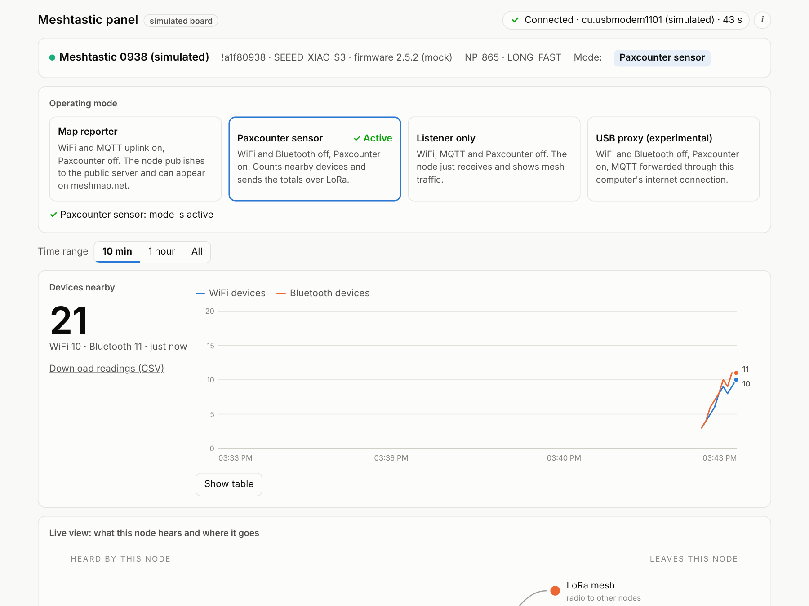

# Meshtastic LoRa mesh for Kathmandu: a control panel, tools and a beginner's guide

**Off-grid text messaging and simple sensors over LoRa radio, using [Meshtastic](https://meshtastic.org/) on cheap ESP32 boards, set up for Nepal (region `NP_865`).**
This repository holds a small web control panel, two diagnostic scripts and a step-by-step guide written for makers, and for anyone who knows WiFi and Bluetooth but is new to LoRa.

📖 **Read the guide online:** <https://saadcaffeine.github.io/Meshtastic-GOSHkathmandu/>


<sub>The control panel running against its built-in simulated board.</sub>

---

## What is this?

[Meshtastic](https://meshtastic.org/) is open-source firmware that turns small, inexpensive LoRa radio boards into a long-range, off-grid mesh network. Nodes pass messages for each other, so no phone signal, WiFi or internet is needed.

This project is a tech demo and an educational experiment with LoRa and sensors for Kathmandu, Nepal. It uses three boards:

| Board | Role in this project |
|---|---|
| [Heltec WiFi LoRa 32 V3](https://heltec.org/project/wifi-lora-32-v3/) | Listener / desk node with a screen |
| [Seeed XIAO ESP32S3 + Wio-SX1262 kit](https://wiki.seeedstudio.com/xiao_esp32s3_&_wio_SX1262_kit_for_meshtastic/) ×2 | One map reporter (WiFi → MQTT → [meshmap.net](https://meshmap.net/)), one Paxcounter sensor |

### What's in the repository

| Folder | What it is |
|---|---|
| [`panel/`](panel/) | A **web control panel** that runs on the computer the board is plugged into (Mac, Linux or Raspberry Pi). It switches the board between operating modes and shows a live dashboard: nearby devices (Paxcounter), nodes and signal, packets, battery, channel use and a raw packet log. Optional **add-on modules** extend it; the first, **Messages**, lets you read and send channel and direct messages. |
| [`tools/`](tools/) | **Diagnostic scripts**: `radio_check.py` compares two boards' radio settings and listens for each other; `paxwatch.py` prints Paxcounter counts and packet totals in the terminal. |
| [`docs/`](docs/) | **The guide**, published with GitHub Pages: LoRa for WiFi and Bluetooth users, hardware, first setup, Nepal's NP_865 region, Paxcounter, map reporting, troubleshooting, FAQ and a glossary. |

---

## Quick start

### 1. Flash and set up a board (5 minutes)

1. Open the [Meshtastic Web Flasher](https://flasher.meshtastic.org/) in Chrome or Edge, pick your board and flash it. Use the same firmware version on every board you want to talk to each other (see [Troubleshooting](docs/troubleshooting.md)).
2. Install the [Meshtastic Python CLI](https://meshtastic.org/docs/software/python/cli/installation/):
   ```bash
   pip3 install --upgrade "meshtastic[cli]"     # macOS: pipx install "meshtastic[cli]"
   ```
3. Set the region for Nepal. The radio stays silent until a region is set:
   ```bash
   meshtastic --set lora.region NP_865
   ```
   Everything else (the `LONG_FAST` preset, the default channel and key) can stay at its default. Full details: [Getting started](docs/getting-started.md).

### 2. Run the control panel

```bash
cd panel
python3 -m venv venv && source venv/bin/activate
pip install -r requirements.txt
python server.py --mock        # try it with a simulated board, no hardware needed
python server.py               # with a real board on USB
```

Open <http://127.0.0.1:8080>. Close the Meshtastic web client and any serial monitor first, because only one program can use the USB port at a time. See [`panel/README.md`](panel/README.md) for running it on a Raspberry Pi and on your network.

### 3. Check two boards can hear each other

```bash
cd tools
python radio_check.py             # run once per board; it compares the saved reports
```

---

## New to LoRa? The 60-second version for WiFi and Bluetooth users

| | WiFi | Bluetooth | **LoRa (Meshtastic)** |
|---|---|---|---|
| Typical range | tens of metres | a few metres to tens of metres | **1–10+ km** line of sight, hundreds of metres in a city |
| Speed | many Mbit/s | about 1–2 Mbit/s | **about 1 kbit/s** (short text and sensor data only) |
| Needs a router or phone? | yes (access point) | yes (paired device) | **no**: every node relays for the others |
| Frequency in Nepal | 2.4 / 5 GHz | 2.4 GHz | **865–868 MHz** (`NP_865`) |
| Power | high | low | **very low**: days on a small battery |

The longer explainer: [LoRa for WiFi and Bluetooth users](docs/lora-for-wifi-and-bluetooth-users.md).

---

## Guide contents

- [LoRa for WiFi and Bluetooth users](docs/lora-for-wifi-and-bluetooth-users.md)
- [Hardware: Heltec V3 and Seeed XIAO ESP32S3](docs/hardware.md)
- [Getting started: flash, set region, send a message](docs/getting-started.md)
- [Nepal: the NP_865 region and frequencies](docs/nepal-np865.md)
- [Paxcounter: counting nearby devices](docs/paxcounter.md)
- [Putting a node on the public map (MQTT and meshmap.net)](docs/map-reporting-mqtt.md)
- [The control panel](docs/control-panel.md)
- [Troubleshooting](docs/troubleshooting.md)
- [FAQ](docs/faq.md) · [Glossary](docs/glossary.md) · [Links and related projects](docs/resources.md)

---

## Status and honesty notes

- Tested with a Heltec V3 and two XIAO ESP32S3 boards on firmware 2.5.x in Kathmandu.
- The panel's simulated board is tested end to end. The real-board parts of the panel (mode switching, USB proxy mode) have had limited hardware testing; please [open an issue](https://github.com/saadcaffeine/Meshtastic-GOSHkathmandu/issues) if something misbehaves.
- This is a community project and is **not affiliated with Meshtastic LLC, Heltec or Seeed Studio**. Meshtastic® is a registered trademark of Meshtastic LLC.
- Radio rules: Meshtastic's `NP_865` settings follow the Nepal Telecommunications Authority's [Radio Frequency Policy 2080](https://www.nta.gov.np/uploads/contents/Radio-Frequency-Policy-2080-English.pdf). You are responsible for operating within your local regulations.

## Credits and related projects

- [Meshtastic](https://meshtastic.org/): [firmware](https://github.com/meshtastic/firmware), [Python library and CLI](https://github.com/meshtastic/python), [web client](https://github.com/meshtastic/web), [web flasher](https://github.com/meshtastic/web-flasher), [protobufs](https://github.com/meshtastic/protobufs)
- [meshmap.net](https://meshmap.net/) by [brianshea2](https://github.com/brianshea2/meshmap.net)
- [RadioLib](https://github.com/jgromes/RadioLib) (the LoRa driver inside Meshtastic) and the [Semtech SX1262](https://www.semtech.com/products/wireless-rf/lora-connect/sx1262) radio chip
- [ESP32-Paxcounter](https://github.com/cyberman54/ESP32-Paxcounter), the original idea behind Meshtastic's Paxcounter module
- [Flask](https://flask.palletsprojects.com/) and [Eclipse Paho MQTT](https://github.com/eclipse-paho/paho.mqtt.python)
- [GOSH: Gathering for Open Science Hardware](https://openhardware.science/)

## License

Code: [GPL-3.0](LICENSE), matching the Meshtastic Python library it builds on. Guide text and images in `docs/`: [CC BY-SA 4.0](https://creativecommons.org/licenses/by-sa/4.0/).
Contributions are welcome; see [CONTRIBUTING.md](CONTRIBUTING.md).
