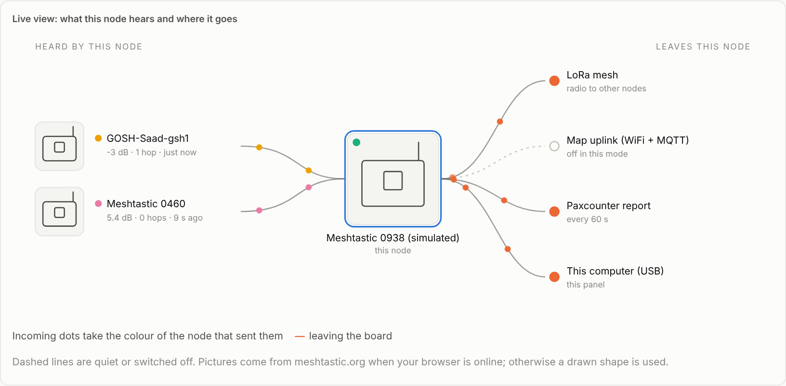
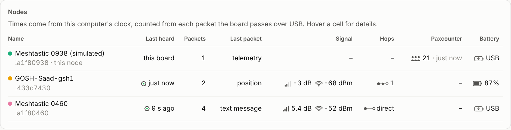
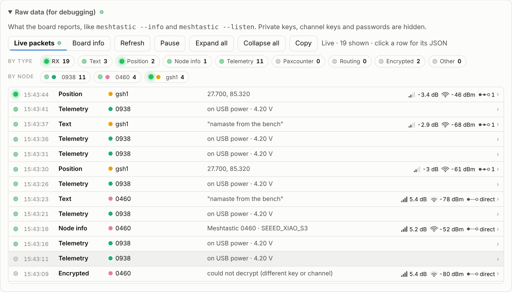

# The control panel

**The control panel is a small Python web app that runs on the computer a Meshtastic board is plugged into.** It switches the board between operating modes with one click and shows a live dashboard of what the radio hears. It runs on macOS, Linux and Raspberry Pi, and works offline.



## Run it

```bash
git clone https://github.com/saadcaffeine/Meshtastic-GOSHkathmandu.git
cd Meshtastic-GOSHkathmandu/panel
python3 -m venv venv && source venv/bin/activate
pip install -r requirements.txt
python server.py --mock     # simulated board, no hardware needed
python server.py            # real board (auto-detects the USB port)
```

Then open <http://127.0.0.1:8080>.

| Option | What it does |
|---|---|
| `--port /dev/cu.usbmodem1101` | use a specific serial port |
| `--mock` | simulate a board (good for demos and development) |
| `--host 0.0.0.0 --token SECRET` | open the panel to your network; changing modes then needs the token |
| `--web-port 8080` | the web page's port |

## Operating modes

| Mode | WiFi | Bluetooth | MQTT | Paxcounter | Use it for |
|---|---|---|---|---|---|
| **Map reporter** | on | off | on (direct) | off | putting the node on [meshmap.net](map-reporting-mqtt.md) |
| **Paxcounter sensor** | off | off | off | on | [counting nearby devices](paxcounter.md) |
| **Listener only** | off | – | off | off | quietly watching the mesh |
| **USB proxy** *(experimental)* | off | off | via this computer | on | Paxcounter plus MQTT without WiFi on the node |

Changing modes writes the settings and the board reboots; the panel waits for it to come back and confirms the mode. **WiFi names and passwords are never changed.**

## What the dashboard shows

- **Connection pill and ⓘ details:** the USB port, connected-since time, reconnects, the USB chip, and the board's model, firmware, MAC address and capabilities.
- **Devices nearby:** the latest Paxcounter total and a WiFi and Bluetooth chart with a table view and CSV download.
- **Live view:** nodes heard, your board, and where the data goes (LoRa mesh, map uplink, Paxcounter, USB). Dots move in each node's own colour.
- **Node status:** battery, channel busy and airtime gauges, plus WiFi, Bluetooth, MQTT and uplink state.
- **Nodes:** last heard (timed by the computer's clock, because boards without GPS have no reliable clock), packets, last packet type, SNR and RSSI bars, hops, Paxcounter count and battery.

  
- **Raw data:** live packets with LED activity lights by type and by node, one line per packet that expands to its JSON, plus the full board settings. **Private keys, channel keys and passwords are hidden.**

  

## Reading the indicators

| Icon | Meaning | Rough guide |
|---|---|---|
| ▂▄▆█ bars | **SNR**, how far the signal is above the noise | above 0 dB is comfortable; LongFast still works to about −15 dB |
| arcs | **RSSI**, received strength | −40 to −75 dBm strong, −95 to −115 dBm weak |
| ●–●–○ chain | **hops**, relays in between | "direct" means heard first-hand |
| ring | **last heard** | empties over 15 minutes |
| half-dial | **channel busy** / **airtime** | above 25% channel busy means the mesh is crowded |

## How it works

- `radio.py` talks to the board with the [Meshtastic Python library](https://github.com/meshtastic/python) and reconnects automatically after reboots or unplugging.
- `server.py` is a [Flask](https://flask.palletsprojects.com/) app. It keeps per-node statistics from received packets, logs Paxcounter readings to `data/pax_log.csv`, and uses [paho-mqtt](https://github.com/eclipse-paho/paho.mqtt.python) to confirm uplink or forward proxy traffic.
- `static/index.html` is a single offline page with no build step. Device pictures come from Meshtastic's [web flasher](https://github.com/meshtastic/web-flasher) images when online, with drawn shapes as a fallback.

Source: [`panel/`](https://github.com/saadcaffeine/Meshtastic-GOSHkathmandu/tree/main/panel).
