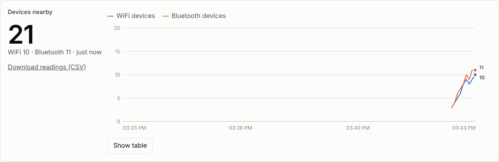

# Paxcounter: counting nearby devices

**The Paxcounter module turns an ESP32 Meshtastic node into a people-counter: it scans for nearby WiFi and Bluetooth devices and broadcasts the counts over LoRa at a set interval.** It doesn't record who is nearby, only how many devices it saw.

## Requirements

- An **ESP32** board (the Heltec V3 and the XIAO ESP32S3 both qualify; nRF52 boards don't).
- Firmware **2.2.17 or newer**.
- **WiFi and Bluetooth must both be turned off** on that node, because the module uses the radios to scan. That means a Paxcounter node can't also report to MQTT over WiFi or talk to the phone app over Bluetooth; use USB, or let another node relay the counts.

Official docs: [Paxcounter module](https://meshtastic.org/docs/configuration/module/paxcounter/).

## Set it up

```bash
meshtastic --set network.wifi_enabled false --set bluetooth.enabled false
meshtastic --set paxcounter.enabled true --set paxcounter.paxcounter_update_interval 60
```

Or click **Paxcounter sensor** in the [control panel](control-panel.md), which applies the same settings.

## Watch the counts

- **Control panel:** the "Devices nearby" card shows the latest total and a WiFi and Bluetooth chart, and offers a CSV download.

  
- **Terminal:** [`tools/paxwatch.py`](https://github.com/saadcaffeine/Meshtastic-GOSHkathmandu/tree/main/tools) prints each report as it arrives, for example `PAX !a1f80460 wifi=3 ble=7 total=10 ##########`.

## A classroom demo

Put one Paxcounter node on a desk and connect a second node to a laptop running the panel. Then walk a few people with phones in and out of the room: the count rises and falls within a report interval or two.

## Good to know

- Phones randomise their WiFi and Bluetooth addresses, so counts are **estimates of devices, not people**: one person may carry several devices or none.
- The counts travel on the default channel, so anyone on that channel can see them.
- The idea comes from the standalone [ESP32-Paxcounter](https://github.com/cyberman54/ESP32-Paxcounter) project.

Next: **[Map reporting](map-reporting-mqtt.md)** →
